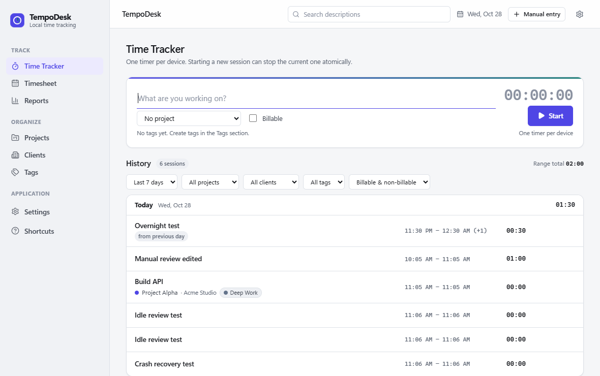

# TempoDesk

**Private, local-first desktop time tracking.** TempoDesk is a Tauri 2 desktop app for Windows and
macOS with one running timer, manual entries, projects/clients/tags, a weekly timesheet, a visual
calendar, reports, CSV export, native tray/menu-bar controls, global shortcuts, opt-in idle review, and local
backup/restore. No account, no cloud, no telemetry. The only optional network feature is a
user-triggered AI summary using your own Gemini API key.



## Status

The **P0 MVP is implemented and verified on Windows 11 (x64)**. An unsigned Intel macOS app/DMG
build succeeds in GitHub Actions, but macOS runtime behavior is **not tested** on hardware; see
[docs/PLATFORM_SUPPORT.md](docs/PLATFORM_SUPPORT.md).
The first P1 feature, a visual day/week calendar timeline, is implemented. Pomodoro,
foreground-app auto-tracking, PDF/XLSX, rates, and sync have not been started.

- 57 Rust tests (42 unit + 15 integration), 26 TypeScript/Vitest tests.
- Real UI flows verified through WebView2 DevTools automation (create project, timer, manual
  entries, edit/delete/undo, overnight validation, tags/clients/projects, timesheet cell editor,
  calendar drag-to-create/edit and day/week switching, reports filters, backup/restore, CSV totals,
  idle review, crash recovery, quit policies,
  close-to-tray, single instance, themes, responsive 860px layout).
- NSIS installer built and installed per-user; installed app launches and writes to the OS
  app-data directory.
- 10,000-entry report benchmark: ~109 ms in a debug build, totals exact.

## Host / toolchain note (material deviation)

The build host has **no MSVC Build Tools and no administrator rights**, so this repository was
built with the **GNU Rust target** `x86_64-pc-windows-gnu` plus MinGW-w64 GCC 16.2.0 (UCRT):

| Tool | Version |
|---|---|
| Windows | 11 x64 (10.0.26200) |
| Node / npm | 24.22.0 / 11.19.1 |
| Rust | 1.99.1 (`stable-x86_64-pc-windows-gnu`) |
| Tauri | 2.12.5 (CLI 2.12.4) |
| React / Vite / TypeScript | 19.3.1 / 7.3.7 / 5.9.3 |
| SQLite | bundled via `rusqlite` 0.40.2 |

A public release should build with the MSVC toolchain and be signed. The GNU link emits a harmless
`.rsrc merge failure: multiple non-default manifests` warning; the app and installer work. See
[Known limitations](#known-limitations).

## Quick start (development)

Prerequisites: Node 20+, Rust 1.85+, WebView2 (Windows), and a C toolchain. On Windows the supported
setup is Visual Studio Build Tools (MSVC) + Rust `x86_64-pc-windows-msvc`. For this host's GNU setup,
ensure MinGW `gcc`/`windres` and `cargo` are on `PATH`.

```bash
npm install
npm run tauri:dev          # starts Vite + Tauri with native window
```

Useful commands:

```bash
npm run build              # TypeScript typecheck + Vite production bundle
npm run test               # Vitest (time math, validation, formatting)
npm run test:rust          # Rust core tests
npm run check              # typecheck + lint + Vitest + core tests + clippy + cargo check
npm run smoke              # launch debug build against an isolated test DB
npm run build:test         # debug build using the TempoDesk Dev identifier (for UI tests)
npm run tauri:build        # production build + installer for the host
```

The installer for this verified Windows build is at:

```text
src-tauri/target/release/bundle/nsis/TempoDesk_0.3.0_x64-setup.exe
```

It installs per-user (no admin prompt) to `%LOCALAPPDATA%\TempoDesk`. The installer is unsigned;
Windows SmartScreen may warn.

## Data isolation: development can never touch your real data

TempoDesk deliberately separates production, development, and test profiles:

| Profile | App identifier | Data directory (Windows) | How it is started |
|---|---|---|---|
| **Production** | `com.tempodesk.desktop` | `%APPDATA%\com.tempodesk.desktop` | Installed app / release build |
| **Development** | `com.tempodesk.desktop.dev` | `%APPDATA%\com.tempodesk.desktop.dev` | `npm run tauri:dev` |
| **Test / automation** | `com.tempodesk.desktop.dev` | `.test-data\run-*` via `TEMPO_DATA_DIR` | `node scripts/launch-test-app.mjs` |

- Release builds **ignore** `TEMPO_DATA_DIR` and always use the production directory.
- Debug builds use a separate `...dev` data directory, the Dev identifier (separate single-instance
  mutex and WebView2 profile), and show **TempoDesk Dev** in the titlebar.
- UI automation includes a hard guard: `scripts/cdp-lib.mjs` refuses to connect to a `production`
  profile unless `ALLOW_PRODUCTION_TESTS=1` is explicitly set. It also fails closed if it cannot
  determine the profile.
- `scripts/launch-test-app.mjs` starts a fresh `.test-data/run-<timestamp>` profile, verifies it is
  the `test` profile, and records the PID. `scripts/stop-test-app.mjs` stops only that PID.
- The installed app can stay open while you develop or run tests; they do not share a database,
  backups, single-instance lock, or WebView2 data.
- `npm run smoke` uses a fresh `.test-data` directory. `npm run smoke -- --release` is blocked
  unless `ALLOW_PRODUCTION_TESTS=1` is set, because even launching production writes
  heartbeat/clean-exit state.

## Five-minute demonstration (M1 checkpoint)

1. **Launch** `TempoDesk_0.3.0_x64-setup.exe` (or `npm run tauri:dev`). The first-run onboarding
   appears (three steps, skippable) and the local SQLite database is created immediately.
2. **Create a project**: *Projects → New project*, name it, choose a color, optionally a client,
   save. It appears in the start-session project selector.
3. **Start a timer**: type a description, choose the project, optionally tags/billable, click
   **Start**. Elapsed time updates every second and survives hiding the window.
4. **Stop**: click **Stop**. A completed entry appears under today, and today's total updates.
5. **Resume**: hover an old entry and click the play icon. TempoDesk creates a **new** session with
   copied metadata; the original entry is unchanged. If another timer is running, it atomically
   stops it after confirmation.
6. **Manual entry**: *Manual entry*, set date/times (tick “Ends next day” for overnight), save.
   Overlaps are allowed and warned about, never silently altered.
7. **Crash recovery**: with a timer running, end `tempodesk.exe` in Task Manager, then relaunch.
   The recovery dialog appears with **Continue timing / Stop at last seen / Stop now**. Nothing is
   discarded automatically.
8. **Restart persistence**: close the window (it hides to the tray by default) and reopen from the
   tray or by launching again. The timer keeps running; the second launch focuses the first
   instance (single instance).
9. **Reports/CSV**: *Reports → Export CSV* uses a native Save dialog and the exported totals match
   the visible filters.
10. **Backup/restore**: *Settings → Data & backup*; create a backup, delete an entry, restore, and
    observe totals recover. A safety backup is written before restore.
11. **Optional summary**: *Reports → Generate summary* works offline. To use AI, configure a Gemini
    key in *Settings → AI summaries*, accept the data-sharing notice, then generate a day, week, or
    month summary from Reports/Timesheet/Tracker.

Uninstall later from *Settings → Apps → TempoDesk* or the installed `uninstall.exe`. User data stays
in `%APPDATA%\com.tempodesk.desktop` unless you delete it.

## Features (P0)

- **Timer**: one active timer, atomic switch, resume-as-new, exact UTC persistence, monotonic
  display ticker, crash/sleep/clock-gap recovery review.
- **Manual entries**: create/edit/delete with soft-delete undo, strict validation, overnight
  support, overlap warnings, sub-minute precision.
- **Bulk actions**: multi-select history entries, delete a batch in one transaction, and undo the
  whole batch; running entries are excluded.
- **Saved tasks**: create/edit/delete task templates with a description, project, tags, and billable
  status. Start from the tracker or native tray. Tracker switching asks before stopping the current
  timer; the tray requires stopping it first. Saved templates are included in backups.
- **Bulk editing**: change descriptions, projects, billable status, or add/remove/replace tags across
  selected completed entries. The batch is transactional; Undo restores metadata together and rejects
  conflicting later edits. Session times are preserved.
- **Complete history**: browse 100 sessions per page. The session count and range total cover every
  matching entry, including histories larger than 1,000 sessions. Day totals are labelled "shown"
  when the list spans multiple pages.
- **High-level summaries**: deterministic local summaries plus optional AI summaries for any
  day/week/month range. AI uses a Gemini API key stored in the OS credential store; requests are
  made only when you click Generate.
- **Organization**: clients, projects (color, client link, default billable), tags; archive and
  soft-delete semantics that never erase history.
- **History**: date range presets/custom, project/client/tag/billable filters, description search,
  day-grouped entries split at local midnight.
- **Timesheet**: Monday/Sunday week start, project+task rows, day cells with underlying sessions,
  cell editor and add-entry flow, day/week totals.
- **Calendar**: visual day/week timeline using the same saved entries, project-colored blocks,
  local-midnight clipping, overlap lanes, 15-minute drag-to-create, and click-to-edit.
- **Reports**: Today/This week/Last week/This month/Custom, shared project/client/tag/billable
  filters, summary cards, daily bar chart, project/client breakdown, sortable detail table,
  RFC 4180 CSV export with matching totals.
- **Native integration**: native titlebar/menu, system tray with live status + start/stop + 5 recent
  entries, close-to-tray, explicit quit policy, configurable global shortcuts with collision
  reporting, OS-theme following, native save/open dialogs, notifications with in-app fallback,
  optional launch at login, single instance.
- **Idle review**: off by default; Windows `GetLastInputInfo` / macOS CoreGraphics aggregate idle
  time; one event per episode; Keep / Remove gap (split) / End at idle start; no auto-deletion.
- **Tracking reminders**: off by default; one native notification (with an in-app toast fallback)
  per "not tracking" episode after a configurable 5–480 minute delay. Starting a timer re-arms it.
- **Data**: versioned migrations, WAL, foreign keys, partial unique index enforcing one active
  timer, transactional backup/restore, safety backup, RFC 4180 CSV, no arbitrary SQL/shell IPC.
- **Automatic backups**: opt-in snapshots once every 24 hours while the app runs, including in the
  tray; overdue snapshots run on launch. Choose a local folder and keep 1–90 snapshots (14 by default).
  Settings shows the last successful backup, location, and any error, with a Back up now action.
  Retention removes only automatic snapshots after a new snapshot succeeds.
- **Accessibility**: labelled controls, visible focus, focus-trapped dialogs, keyboard shortcuts,
  reduced-motion support, responsive layout down to ~850px.

## Architecture

```text
core/                     # Tauri-free Rust crate: domain, SQLite, reporting, portability
  src/domain/             # timer, idle, reports, timezone math, validation, backup/CSV
  src/storage/            # migrations, repositories, settings
  migrations/0001_init.sql
  tests/                  # filter consistency + 10k-entry performance tests
src-tauri/                # Tauri shell: typed IPC, tray, menus, shortcuts, idle poller
  src/commands.rs         # validated command surface (no SQL/shell exposure)
  src/platform/           # tray, native menu, global shortcuts, idle API, window/quit
src/                      # React 19 + TypeScript UI
  app/                    # provider, theme, navigation, error boundary
  features/               # tracker, entries, timesheet, reports, org, settings, onboarding
  components/             # accessible primitives and toasts
docs/                     # architecture, test report, platform support, screenshots
scripts/                  # launch smoke + WebView2 CDP UI verification scripts
```

- All business logic, validation, timer transitions, report math, CSV and backups run in Rust.
- The renderer receives typed serde payloads and emits typed events; it has no SQL or shell access.
- SQLite lives in the OS app-data directory. Timestamps are integer UTC epoch milliseconds
  (second-aligned); durations are integer seconds. Local-day allocation clips intervals at local
  midnight and is DST-safe.
- More detail: [docs/architecture.md](docs/architecture.md).

### IPC surface (summary)

`get_app_status`, `start_timer`, `switch_timer`, `stop_timer`, `resume_entry`,
`resolve_recovery`, `list_entries`, `create_manual_entry`, `update_entry`,
`delete_entry`/`restore_entry`, `delete_entries`/`restore_entries` (bulk),
`list/save/archive` for clients, projects and tags,
`get_timesheet`, `get_report`, `export_report_csv`, idle review list/resolve,
`get/update_settings`, `save_backup`, `preview_restore`, `restore_backup`, `quit_app`,
`get_platform_info`, `get_shortcut_status`, `get_ai_status`, `set_ai_api_key`,
`delete_ai_api_key`, `test_ai_connection`, `generate_summary`.

Events: `timer-state-changed`, `entries-changed`, `data-changed`, `settings-changed`,
`idle-review-required`, `shortcut-status`, `window-focused`, `quit-requested`, `navigate`,
`new-entry`, `focus-search`, `show-shortcuts`, `app-error`.

## Data & privacy

- Production database: `%APPDATA%\com.tempodesk.desktop\tempodesk.db` (Windows),
  `~/Library/Application Support/com.tempodesk.desktop/tempodesk.db` (macOS),
  `~/.local/share/com.tempodesk.desktop/tempodesk.db` (Linux).
- Development database: sibling `com.tempodesk.desktop.dev`; test databases live under
  `.test-data/` in this repository and are git-ignored.
- Pre-restore safety backups: `<app-data>/backups/`.
- No network calls by default and no background network activity. The only network feature is
  optional AI summaries: when enabled and explicitly triggered, aggregated timesheet data for the
  selected range (and task descriptions if enabled) is sent to Google Gemini using your API key.
  Local summaries never leave the device.
- No analytics, accounts, cloud sync, screenshots/keystrokes/URLs/window titles. Idle detection is
  opt-in, local-only, and only reads the OS aggregate idle duration.
- Backups are plain-text JSON and can contain sensitive work/client names — store them privately.
- Backup format v2 includes task templates and can restore older v1 files. Automatic-backup enablement
  and folder paths are device-specific and excluded from backups; restore leaves scheduling off.
  Automatic snapshots default to `<app-data>/automatic-backups/`. A chosen folder receives a dedicated
  `TempoDesk automatic backups` subfolder. Manual and pre-restore safety backups are retained separately.
- Tauri capabilities are least-privilege. No filesystem or shell plugin is registered; file writes
  are limited to validated absolute paths with `.csv`/`.json` extensions chosen through native
  dialogs.

## Configuration defaults

| Setting | Default |
|---|---|
| Theme | Follow OS |
| Start of week | Monday |
| Time format | OS locale |
| Time zone | System |
| Close window to tray | On |
| Launch at login | Off |
| Idle detection | Off, 5-minute threshold when enabled |
| Tracking reminder | Off, 30-minute delay when enabled |
| AI summaries | Off; Gemini; model `gemini-2.5-flash`; descriptions included only after consent |
| Open/hide shortcut | `CommandOrControl+Shift+T` |
| Start/stop shortcut | `CommandOrControl+Shift+Y` |

All are editable in Settings, stored locally.

## AI summaries (optional)

1. Open **Settings → AI summaries**.
2. Toggle **Enable AI summaries**, review and accept the data-sharing notice, and optionally disable
   sending task descriptions.
3. Paste a Gemini API key and click **Save key**. It is stored in Windows Credential Manager /
   macOS Keychain and is never returned by the app API or included in backups. The dev/test profiles
   use separate credential accounts.
4. Use **Generate AI summary** on Reports, **Summarize week** on Timesheet, or **Summarize today**
   on the tracker. Use **Local only** (or leave AI disabled) for a fully offline summary.

A request is made only when you click generate; there is no background call, retry loop, or
telemetry. If the key is missing, invalid, rate-limited, or offline, TempoDesk keeps working and
offers the local summary.

## Known limitations

- **macOS runtime behavior is unverified** on this host (no macOS hardware). The Intel app/DMG
  builds successfully in GitHub Actions; follow the runtime checklist in
  [docs/PLATFORM_SUPPORT.md](docs/PLATFORM_SUPPORT.md).
- **Live Gemini calls are unverified** without a real API key. Local summaries, consent gating,
  prompt construction, response parsing, and OS credential-store round trips are tested.
- **Global hotkeys could not be exercised by synthetic input** in the automation session. The
  shortcuts register successfully (status reports OK), invalid bindings and collisions are handled,
  and the toggle logic is shared/tray-tested; a physical key press must be verified manually.
- **Tray menu clicks and native notification permission prompts** require manual OS interaction;
  their creation paths and fallbacks were verified in code/launch, not by automated clicks.
- The Windows build is **unsigned**, and built with the **GNU toolchain** (see host note). The
  linker prints a manifest-merge warning. Use MSVC for a production release.
- The app uses the OS WebView (WebView2/WKWebView), not native WinUI/SwiftUI content widgets; native
  titlebar, menus, tray, shortcuts, dialogs, and notifications are genuine OS integrations.
- CSV uses UTF-8 without a BOM for spec compliance; Excel may need “Import” for non-ASCII text.
- Timesheet/History show sub-minute durations as seconds (`3s`) and minute-level ranges for longer
  entries; the underlying data keeps exact seconds.

## Project website

The dependency-free static website lives in [`site/`](site/) and deploys through
[`.github/workflows/pages.yml`](.github/workflows/pages.yml). Preview it locally with:

```bash
npx vite site
```

## Documentation

- [CHANGELOG.md](CHANGELOG.md) — release notes and known limitations.
- [IMPLEMENTATION_PLAN.md](IMPLEMENTATION_PLAN.md) — milestones, FR checklist, acceptance matrix.
- [docs/architecture.md](docs/architecture.md) — data model, time math, IPC, platform behavior.
- [docs/TEST_REPORT.md](docs/TEST_REPORT.md) — commands, results, evidence, untested items.
- [docs/PLATFORM_SUPPORT.md](docs/PLATFORM_SUPPORT.md) — verified/unsupported features per OS.
- [scripts/README.md](scripts/README.md) — how to rerun the WebView2 UI verification suite.

## License

Original work created for this project. No Clockify branding, assets, or source code is included.
